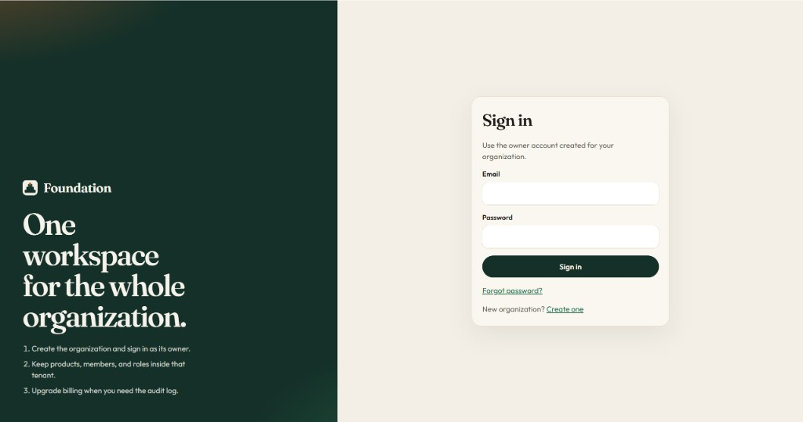
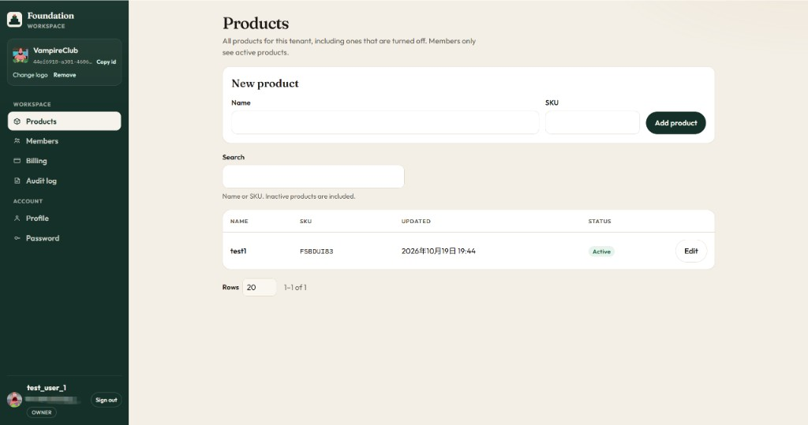
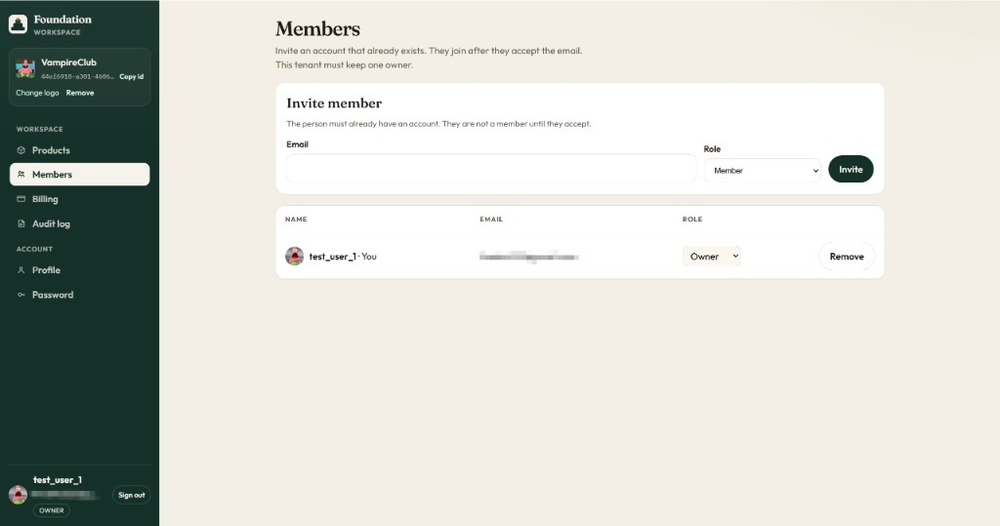
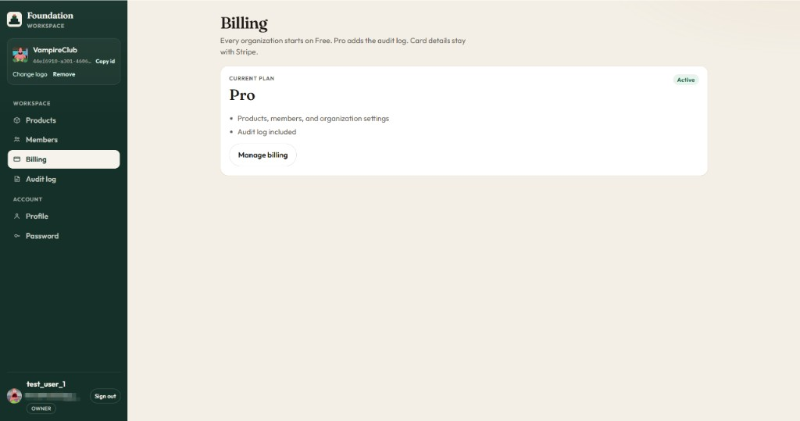
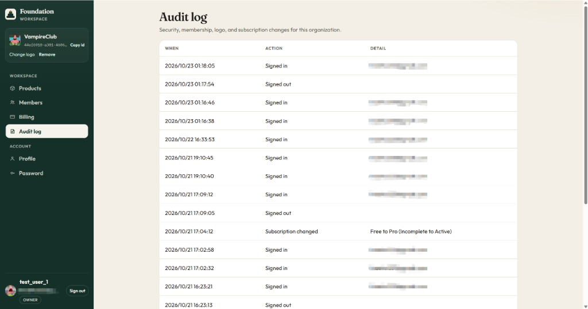
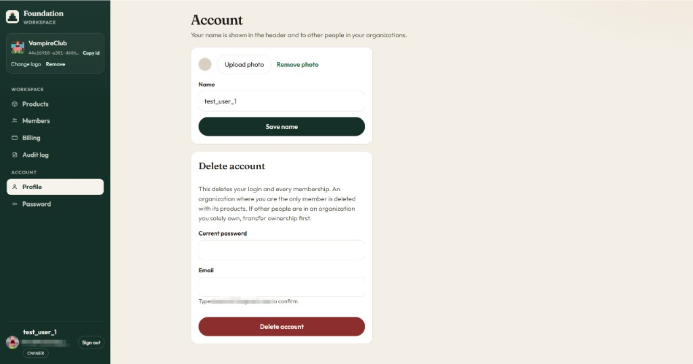
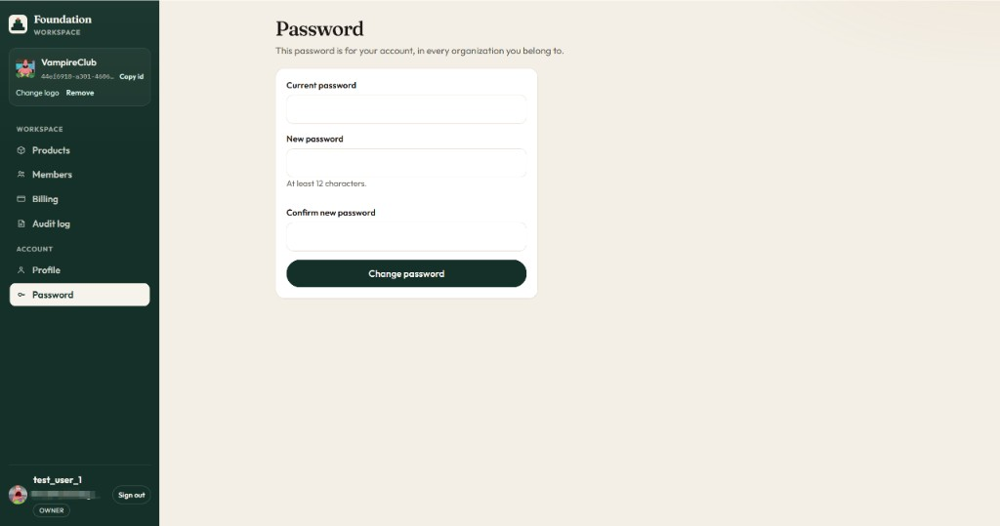

# saas-foundation-web

[](https://github.com/TiaoTiaoLin/saas-foundation-web/actions/workflows/ci.yml)

Browser client for the [saas-foundation](https://github.com/TiaoTiaoLin/saas-foundation) API.

The deployed app is <https://saas-foundation-web.linzehui233.workers.dev/>. The first request after the API has been idle can take half a minute.

## Screenshots

| | |
| --- | --- |
|  |  |
| Sign in | Products, visible only to this organization |
|  |  |
| Members and roles | Billing on the Pro plan (Stripe test mode) |
|  |  |
| Audit log, open on Pro | Profile, photo, and account deletion |
|  | |
| Change password | |

## Walk through

1. Create an organization.
2. Add a product.
3. Invite a member. They need an existing account and must accept the email.
4. From Billing, upgrade to Pro. Checkout uses Stripe test mode: card `4242 4242 4242 4242`, any future expiry, any CVC. Refresh after Stripe returns. The audit log opens once the webhook has stored the subscription.

## Run

1. Start the API on port 8080. See the API repo.
2. From this directory:

```bash
npm install
npm run dev
```

3. Open <http://localhost:5173>.

The dev server proxies `/api` to `http://localhost:8080`. To call another origin, set `VITE_API_BASE_URL`. That origin must be allowed by `saas.cors.allowed-origins` on the API.

## Checks

| Command | What it does |
| --- | --- |
| `npm run lint` | ESLint with the TypeScript and React Hooks rules |
| `npm test` | Vitest unit tests for the API client, the session helpers, and form validation |
| `npm run test:coverage` | The same tests with a coverage report in `coverage/` |
| `npm run build` | Type-check and production build |

CI runs all four on every push and pull request.

The API client tests cover the token refresh: a 401 triggers one refresh and one retry, concurrent refreshes share a single request, and a rejected refresh token signs the user out.

## Session storage

The access and refresh tokens are kept in `localStorage` so a reload keeps you signed in. That means a cross-site scripting bug could read them. The app does not render user HTML, and access tokens last 15 minutes, but an `httpOnly` cookie served by the API is the stronger design if this grows beyond a demo.

## Screens

| Screen | Route | What it calls |
| --- | --- | --- |
| Create organization | `/signup` | `POST /api/v1/tenants/registrations` |
| Sign in | `/login` | `POST /api/v1/auth/login` |
| Stay signed in | | `POST /api/v1/auth/refresh` |
| Sign out | | `POST /api/v1/auth/logout` |
| Forgot password | `/forgot-password` | `POST /api/v1/auth/password-resets` |
| Reset password | `/reset-password` | `POST /api/v1/auth/password-resets/confirm` |
| Products | `/` | `GET`, `POST /api/v1/products`, `GET`, `PUT`, `DELETE /api/v1/products/{id}` |
| Members | `/members` | `GET`, `POST /api/v1/members`, `PATCH`, `DELETE /api/v1/members/{userId}` |
| Accept invite | `/invites/accept` | `POST /api/v1/membership-invites/accept` |
| Billing | `/billing` | `GET /api/v1/billing`, `POST /api/v1/billing/checkout`, `POST /api/v1/billing/portal` |
| Audit log | `/audit` | `GET /api/v1/audit` |
| Password | `/password` | `POST /api/v1/auth/password` |
| Account | `/account` | `GET`, `PUT /api/v1/auth/profile` |

Authenticated calls send `Authorization: Bearer`. The tenant id is the one in the access token.
